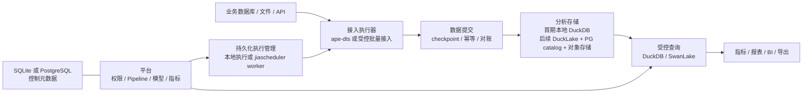

# DTS Platform：技术、产品与单人创业可行性评估

调研日期：2026-10-08（Asia/Shanghai）。本地平台基线：`dev`，HEAD `3082060`。用户约束：目前只有创始人一人，没有客户；希望以 Rust + DuckDB 为核心，面向中小企业，兼具单机和分布式部署，维护并回馈 ape-dts、jiascheduler、SwanLake 上游。

## 判断与适用范围

**值得做一个有退出条件的客户验证项目；现阶段不值得按“完整通用数据中台 + 自研分布式 SQL 引擎”投入。** DuckDB 能降低一类分析工作负载的部署和资源成本，这是技术入口；订单、库存、经营分析等可反复交付的场景、可信数据及低支持成本，才可能成为商业优势。Rust 本身、DuckDB 本身、功能页面数量和“支持分布式”标签都不能证明有人付费。

本次直接阅读平台和三个本地仓库、Datay 固定提交源码、官方数据库和产品文档。平台执行了前端构建、前端测试和 Rust 离线编译检查（结果见末尾）。没有运行生产数据链路，没有做容量压测、故障注入、恢复演练，也没有访谈客户。因此以下结论分别标记为代码事实、官方声明、推断或待验证假设；不能据此宣称已生产可用、性能超过 Java 方案、市场需求已成立。

详细证据分册：

- [Datay 源码与产品调研](D:/rustpro/dts-platform/docs/research/2026-10-08-datay-review.md)
- [三个上游仓库审计](D:/rustpro/dts-platform/docs/research/2026-10-08-upstream-audit.md)
- [DuckDB、DuckLake 与竞争路径](D:/rustpro/dts-platform/docs/research/2026-10-08-duckdb-strategy.md)

## 一、先修正三个关键认知

### 1. Datay 已有分布式任务能力

用户最初认为 Datay 没有分布式能力。当前 README 声明可拆分 master/worker；固定提交源码中的 Redis 事件分发、leader 选举和 worker 执行链路也支持这一点。因此不能把“我支持分布式、它不支持”当作定位依据。本次检视未找到单条 SQL 跨多个 worker 的执行计划切分、数据交换和最终归并实现；这与其已有任务分布式并不矛盾。其 README 中低资源运行和性能表述也仍需要独立压测。[Datay 仓库](https://github.com/yuyuejia/datay)、[固定提交](https://github.com/yuyuejia/datay/tree/ccab0ed7896431ce0984faad5f53fbda1697b8d2)。

Datay 更值得借鉴的是业务闭环：数据建模、模型物化、指标定义、权限范围和指标问数相连。当前 DTS Platform 的重点仍偏同步管理、运行监控和 SQL 入口。具体实现与局限见竞品分册，不能将功能存在等同于成熟可靠。

### 2. DuckDB 的并发要按版本与部署方式区分

原生文件的进程内模式需要一个拥有读写连接的进程；它内部可以有多个连接和线程。当前官方文档还提供 Quack 客户端/服务器路径，并推荐 DuckLake + PostgreSQL catalog 实现多个 DuckDB 实例协调读写。Quack 的公开稳定性标记和版本差异应保留，不能把旧文档的文件锁限制推成“DuckDB 永远无法支持多进程”，也不能把远程数据库协议当成单 SQL 的分布式执行器。[DuckDB 当前并发文档](https://duckdb.org/docs/current/connect/concurrency)。

DuckLake 是 SQL catalog 管理元数据、Parquet 保存数据的湖仓格式，不应称为 Iceberg 格式；两者共享部分生态构件，并非同一套表元数据。选择 DuckLake 后仍要负责文件组织、更新删除语义、提交重试、小文件整理、快照保留、孤儿文件清理和备份协调。[DuckLake 官方介绍](https://ducklake.select/docs/stable/introduction)。

### 3. “避免 Hadoop”不能取代客户价值定位

目标客户可能现在使用 Excel、业务系统报表、数据库 SQL 或现成 BI，而非 Hadoop。竞争比较必须包含这些实际替代方案。让原本没有 Hadoop 的公司“摆脱 Hadoop”并不能直接带来预算。是否需要独立平台、谁有预算、谁负责维护、数据接入是否允许，是需要先访谈的问题。

## 二、当前平台已有资产与交付缺口

现有资产包括 Rust workspace 分层、Repository traits、SQLite/PostgreSQL 元数据后端、数据源和 Pipeline 管理、JWT 登录、角色/权限数据模型、WebSocket、引擎 Interface、jiascheduler HTTP client、Arrow Flight SQL 查询入口、AI SSE 接口、React 前端、CI 和较多测试。这些适合作为后续产品基础，重写全部代码没有依据。Rust 客户端经 DuckDB C API 调用同一数据库引擎；因此平台使用 Rust，不能自动推出 SQL 执行比 Java/JDBC 平台快几个数量级，端到端性能要单独验证。[DuckDB Rust 客户端](https://duckdb.org/docs/current/clients/rust/overview)。

但仓库文档中的“已完成”“RBAC 多租户”“引擎集成”要降低为可核验的具体能力。下面是直接影响交付的问题，而不是为了追求架构纯洁性的建议。

| 优先级 | 代码事实 | 用户影响 | 证据 |
|---|---|---|---|
| P0 | `DatasourceService` 把密码保存为 `enc:` 加原文 | 并未加密，数据库/备份泄漏即可获得业务数据库凭据 | [datasource_svc.rs:48](D:/rustpro/dts-platform/crates/dts-server/src/services/datasource_svc.rs:48) |
| P0 | 查询 handler 仅校验 JWT，丢弃 claims；QueryService 只有共享 endpoint，执行任意 SQL | 分析数据未建立可信租户隔离；权限数据模型并不代表查询权限已生效 | [query.rs:39](D:/rustpro/dts-platform/crates/dts-server/src/api/query.rs:39)、[query_svc.rs:75](D:/rustpro/dts-platform/crates/dts-server/src/services/query_svc.rs:75) |
| P0 | WebSocket handler 根据 task_id 订阅日志，未校验身份和任务归属；系统管理部分 handler 接受请求 tenant_id 并仅验证登录 | 日志及管理操作存在访问控制缺口 | [task_log.rs:80](D:/rustpro/dts-platform/crates/dts-server/src/ws/task_log.rs:80)、[system.rs:110](D:/rustpro/dts-platform/crates/dts-server/src/api/system.rs:110) |
| P0 | 引擎生成 run_id，调度器又生成不同 UUID 插入 task_run，却用引擎 run_id 更新；更新返回 false 被忽略 | 运行记录可能一直停在 running，监控/AI 分析建立在错误状态上 | [scheduler/mod.rs:98](D:/rustpro/dts-platform/crates/dts-server/src/services/scheduler/mod.rs:98)、[task_run.rs:65](D:/rustpro/dts-platform/crates/dts-backend-sqlite/src/repo/task_run.rs:65) |
| P0 | 前端映射步骤为 EmptyState，创建请求不提供表映射；后端反序列化失败回退默认空配置 | 页面能创建任务不等于能创建有效同步配置；配置错误可能被隐藏 | [MappingStep.tsx:5](D:/rustpro/dts-platform/web/src/pages/tasks/create/MappingStep.tsx:5)、[TaskCreatePage.tsx:34](D:/rustpro/dts-platform/web/src/pages/tasks/create/TaskCreatePage.tsx:34)、[scheduler/mod.rs:218](D:/rustpro/dts-platform/crates/dts-server/src/services/scheduler/mod.rs:218) |
| P0 | 适配器固定 Snapshot/Write/Snapshot_Direct_Write，并仅提取 source_table | 没有根据 SyncMode 接通 CDC，目标表/模式映射未完成；值与本地 ape-dts parser 的枚举不匹配 | [adapter.rs:532](D:/rustpro/dts-platform/crates/dts-engine-ape/src/adapter.rs:532)、[adapter.rs:552](D:/rustpro/dts-platform/crates/dts-engine-ape/src/adapter.rs:552)；上游分册 |
| P0 | TaskSync 创建的是 curl 调用平台 start；配置 service_token 按普通 JWT 解析，回调路径在平台路由中未发现 | 调度触发的身份和完成协议不完整；curl 成功最多代表提交请求成功，不代表数据任务完成；远端 worker 仍未承担同步计算 | [sync.rs:49](D:/rustpro/dts-platform/crates/dts-scheduler-client/src/sync.rs:49)、[tasks.rs:129](D:/rustpro/dts-platform/crates/dts-server/src/api/tasks.rs:129)、[app.rs:150](D:/rustpro/dts-platform/crates/dts-server/src/app.rs:150) |
| P0 | Docker runtime 只复制 dts-server，却配置不存在的 ape-dts binary；健康检查使用 `/api/v1/health`，实际路由为 `/health` | 安装包与文档不能作为可交付部署方案 | [docker/Dockerfile:63](D:/rustpro/dts-platform/docker/Dockerfile:63)、[docker/Dockerfile:77](D:/rustpro/dts-platform/docker/Dockerfile:77)、[app.rs:209](D:/rustpro/dts-platform/crates/dts-server/src/app.rs:209) |
| P1 | 查询结果全部收集到 Vec 再转 JSON；Decimal/日期时间等未识别 Arrow 类型返回 null | 大结果可能撑满平台内存；金额和业务日期可能静默损坏 | [query_svc.rs:119](D:/rustpro/dts-platform/crates/dts-server/src/services/query_svc.rs:119)、[query_svc.rs:376](D:/rustpro/dts-platform/crates/dts-server/src/services/query_svc.rs:376) |
| P1 | AI 问数主要是前端 prompt + 通用 chat，未加载真实 schema/指标语义；提示允许推测 | 可能生成不存在的表/字段或错误口径，无法作为可信经营问数产品 | [analysis/index.tsx:35](D:/rustpro/dts-platform/web/src/pages/analysis/index.tsx:35)、[api/ai.rs:54](D:/rustpro/dts-platform/crates/dts-server/src/api/ai.rs:54) |
| P1 | 运行、取消、日志广播注册主要在进程内，提交发生在运行记录落库之前 | 重启、多副本、DB 失败时缺少可证明的恢复和一致性语义 | [service.rs:33](D:/rustpro/dts-platform/crates/dts-engine-ape/src/service.rs:33)、[scheduler/mod.rs:40](D:/rustpro/dts-platform/crates/dts-server/src/services/scheduler/mod.rs:40) |

**计划能力与交付前置条件：** 本地 ape-dts 尚无 DuckDB/DuckLake/Parquet sink，平台数据源界面也没有 DuckDB 目标。用户明确计划开发连接器并贡献社区，这是合理的新 feature，不是 ape-dts 的 bug。它意味着当前业务数据落仓闭环仍待建设，不能被平台已有 SQL 页面代替。[datasources.tsx:29](D:/rustpro/dts-platform/web/src/pages/datasources.tsx:29)；上游分册。

安全改造要到实际执行点：执行身份、可见 catalog/表、允许操作、资源额度、结果及日志归属一起校验。仅前端隐藏按钮、给 SQL 加 tenant WHERE、允许 SELECT 前缀都不足。DuckDB 官方明确把不可信 SQL 当作代码处理，要求进程/容器与文件、网络资源隔离；只读连接不能自动解决任意文件读取或数据外传。[DuckDB 安全模型](https://duckdb.org/docs/current/operations_manual/securing_duckdb/overview)。

当前 Compose 将 SwanLake 连接到平台 PostgreSQL 元数据库。这可演示查询连通性，但不能替代业务数仓的 Catalog、Dataset、模型、指标和生命周期。控制元数据和客户业务数据应分别建模、授权和备份；不宜把生产业务源库长期联邦扫描作为默认数据仓库。

## 三、对“单机 + 分布式”给出可以交付的定义

| 能力层次 | 能解决什么 | 必要实现 | 建议时机 |
|---|---|---|---|
| 单机完整产品 | 一台机器接入、加工、查询、恢复 | 一个受控 writer owner；批次事务、资源限制、备份、可重跑 | 首个 MVP |
| 分布式任务执行 | 多个同步/加工任务并行，worker 可以部署到业务网段 | 持久队列或调度状态、worker 注册、租约、幂等 attempt、断点、取消、重试和确认 | 已有付费试点需要远端采集/多任务隔离时 |
| 查询横向扩容 | 更多用户同时查共享仓湖，避免租户争抢资源 | 共享快照与 catalog、查询路由、每查询/租户资源限制、缓存和可见版本约束 | 并发压力实际超过单机验收目标时 |
| 多节点共同执行单 SQL | 一个查询在多个节点拆分计算 | 查询计划切分、shuffle、分布式 join/聚合、容错、成本模型、spill和取消传播 | 单人创业阶段不自行承诺；客户需求证实后优先接入已有引擎 |

前两层加上可靠共享存储已经是有价值的分布式系统。第三层可让不同查询在不同节点运行，每条查询仍可由一个 DuckDB 节点执行。共享存储能扩展数据保存量，多查询分发能扩展并发，二者均不能保证单个大 join 随节点数加速。

MotherDuck 官方也区分平台分布式与每条云端查询在单节点执行；产品横向扩展和私有多租户隔离不能被简化为“有没有 MPP”。它的存在说明 DuckDB 周边已有竞争，不能把技术路线的可实现性当作本项目的市场验证。[MotherDuck 扩展架构](https://motherduck.com/learn/how-motherduck-scales-distributed-architecture/)。

## 四、建议的改造形态



这是建议架构，图中的数据提交、仓湖写入、建模和消费闭环还未全部实现。

1. **保留平台，压缩默认部署。** 首期平台、受控本地执行器和 DuckDB owner 可以在同机部署，SQLite 保存控制元数据；用户只需要一个安装入口。jiascheduler 集群、对象存储、PostgreSQL、DeerFlow、K8s 不应全部成为体验首个场景的前置条件。可独立演进的进程并不必须暴露为多套运维产品。
2. **把接入、提交、查询的 Interface 定清楚。** Pipeline 定义包含 source、target、mapping、sync mode、schema policy；PipelineRun/attempt 有唯一持久身份。接入事件带主键、op、源位置、schema version；提交模块在目标事务提交后才推进可恢复 checkpoint。若提交成功但 checkpoint 未推进时宕机，必须用稳定 batch 身份、源位置和业务键防止重放重复；native 模式可在同一目标事务记录 commit ledger，湖仓与平台元数据分离则需要可恢复的对账协议。DuckLake 无唯一约束，MERGE 前仍需按业务键与源位置处理重复及乱序事件。不能未经证明标称 exactly-once。
3. **先做最窄数据通路。** 建议选择一个实际业务源，必要时补 CSV，完成全量快照 → staging → 校验 → 原子发布 → SQL 模型 → 一个可信指标 → 报表/导出。若做定时增量，需要稳定游标与删除/tombstone 契约；单纯 updated_at 或自增 ID 轮询不能自动捕获硬删除。CDC 只有客户刷新需求证实时优先，启用后再验 insert/update/delete、快照切换、重复重放和 DDL。首版只接通一条流程和必要页面，可暂关闭未完善的 AI/集群入口。
4. **选择一个仓湖写入实现。** 如果首期需要本地持久 DuckDB，接入 subprocess 不应和 SwanLake 各自长期打开同一个 native 文件；通过统一 owner 提交。当前 SwanLake 每 session 建独立 in-memory 实例，并非现成 native owner；需要新增持久实例与共享连接管理，或者由独立 owner 提供最小 SQL 接口再接入 SwanLake。仅修改初始化 ATTACH 或同处一个进程都不足以证明共享事务视图。若明确需要多个节点协调写入，采用 DuckLake + PostgreSQL catalog + 本地/对象存储，并承担维护与恢复。不要同一时期分别自造本地文件多 writer 协议和湖仓事务协议。
5. **SwanLake 用来承接 SQL 服务。** 先修其版本/鉴权/会话/数据连接契约，把可靠查询服务需要的通用改动回馈上游；平台负责业务身份、权限、Dataset/Metric、使用额度与安装体验。没有证据要求把 SwanLake fork 成自研 MPP。
6. **jiascheduler 负责触发或真正分配执行，二者要明确。** trigger 的成功状态与 PipelineRun 的完成状态分开。若选择 worker 执行 ape-dts，worker 应持有 attempt 租约、按需取得限定凭据、持续心跳并提交终态；平台不能把 curl exit code 当作数据同步终态。
7. **建模和指标先于通用 AI 问数。** 用有版本的 SQL 模型、事实/维度、指标公式/粒度/时间口径、权限范围建立语义。优先让 AI 选择已定义指标与筛选条件，而非直接猜测整条 SQL。AI 故障辅助可保留为可选能力，避免外部 Agent 成为基础运行依赖。

## 五、上游分支政策：方向正确，落地要更精确

用户希望主分支纯净、开发分支承载补丁。这是可维护的方向，但主分支应该使用项目社区真实默认名；当前三个本地项目的默认分支都是 `main`，无需为了术语强行改为 `master`。`origin` 应代表自己的 fork，`upstream` 代表社区仓库；主分支只同步社区，不能混入产品补丁。

推荐状态：

```text
upstream/main    社区跟踪引用
main             与经过核验的 upstream/main 一致
dev              少量下游集成补丁
fix/<问题>       单项通用 bugfix，用于社区 PR
feat/<特性>      单项可复用 feature，用于社区 PR
release/<版本>   需要维护交付线时再创建
```

实际操作需先识别本地未提交更改、已提交下游补丁和 fork 差异，安全保留后再安排同步；此次研究不执行 reset、rebase、checkout 或创建分支。本地 `origin/main` 相等只能说明与缓存的 fork 引用相等，不能证明与社区当前主线一致。三个基础仓库目前还有主分支工作区修改，详见上游分册。

生产依赖应锁定 release/tag/commit 和镜像 digest；社区 main 更新先通过兼容性矩阵与合同测试，随后进入平台 release。至少记录平台、ape-dts CLI 配置协议、jiascheduler HTTP 模型、SwanLake/Arrow、DuckDB、DuckLake extension/catalog spec 版本。平台特有 UI/业务权限/商业功能留在平台，公共连接器/驱动/协议 bug 优先上游，减少永久 fork 面积。`dev` 也不能成为难以拆分的一整包改动。

**授权是商业模式的实质条件。** 本次直接核验：DTS Platform 为 Apache-2.0，ape-dts 为 **AGPL-3.0**，jiascheduler 为 Unlicense，SwanLake、DuckDB、DuckLake 为 MIT。这不是统一的宽松许可证组合。ape-dts 的社区 LICENSE 同样是 AGPL；修改该项目、分发二进制或让用户与满足条件的修改版远程交互，涉及对应源码及其他许可义务。第 13 节的网络交互要求需结合实际实现评估，不能认为“用 CLI 子进程调用就自动规避”，也不能未经组合关系分析断言整个平台必然必须改成 AGPL。[ape-dts LICENSE](https://github.com/apecloud/ape-dts/blob/main/LICENSE)、[GNU 官方 FAQ](https://www.gnu.org/licenses/gpl-faq.en.html#AGPLv3InteractingRemotely)。

商业上可按 AGPL 提供修改源码与源码获取入口，并销售标准实施、托管和支持；如果计划闭源企业功能或商业再授权，应在大量耦合前确认实际 Interface、代码组合、部署和权利人授权条件。贡献 DuckDB 连接器与当前开源方向相容，但不能因为自己写了连接器就取得整个 ape-dts 的再许可权。分发时还应核对 LICENSE、NOTICE、改动标记、依赖与镜像及品牌要求；当前 Apache 发布和第三方贡献也不能被假定可随意收回或改为双许可证。[Apache-2.0 正文](https://www.apache.org/licenses/LICENSE-2.0)、[DuckDB LICENSE](https://github.com/duckdb/duckdb/blob/main/LICENSE)。

## 六、单人团队的市场与商业策略

### 初始客户是假设，需要验证

优先寻找一类有多套业务数据、每天人工合并 Excel、没有专职数据工程团队、接受私有部署且预算负责人明确的企业。行业选择服从创始人的真实触达渠道，不能仅因技术适合就断言制造业/零售/电商一定购买。客户较多的 ERP/软件实施商也可作为访谈和交付渠道；避免无客户基础时先做大范围 SaaS 多租户运营。

一条可以验证的价值主张是：**把两三个现有数据来源变成每天自动更新、口径一致、能对账的经营报表，在现有服务器部署并提供恢复保障。** 用一个实际决策问题定义验收，例如订单收入/退货/毛利，或库存周转/缺货；不要第一期同时涵盖所有业务域。

访谈应问最近一次报表怎么做、谁做、耗时、出错损失、现有工具为何不够、数据权限/接入限制、谁签字付款、愿不愿提供样本与付费试点。只问“你觉得轻量中台有没有价值”会收集到无法指导产品的赞同。

### 商业化从标准交付开始

客户验证、最小开源版本与有范围的付费试点可以并行，不必等完整社区版或 stars 增长才报价。后续再建立标准实施/模板包、年度维护、备份/升级/支持，需求重复后才做企业订阅或托管。早期可以同时保持产品与服务，但要约束定制范围，将通用部分积累为可复用模板和连接器；不能让每个客户变成一份无法维护的 fork。

社区版应能独立完成核心链路、导出数据并可靠运行。企业版候选包括 SSO、集中审计与策略、组织治理、受管理 HA/备份恢复、统一多节点管理、升级支持等，但只有客户反复提出且愿付费的项目才进入开发。基础数据正确性和安全修复不应作为付费门槛。托管、实施和支持都可能有价值；开源商业化不必从许可证收费开始。

价格现阶段没有证据。先针对有明确定义成果的试点报价，记录部署/实施/支持小时数、基础设施成本、故障赔付风险、持续收入和续费原因，再确定标准套餐。不要从竞品资源参数或 stars 推导价格/市场规模。

差异化候选：本地私有部署的实际易用性、某行业/软件的数据连接与模板、可检查的对账与故障恢复、稳定的指标口径，以及低实施支持成本。每一项都需要客户证据；Rust 资源效率要用相同数据、硬件、并发、正确性口径的端到端测试证明。

## 七、分阶段投入与继续/收敛条件

以下时间是单人工作拆分建议，访谈、数据授权与客户响应会影响日历进度，不是交付承诺。

| 阶段 | 主要工作 | 可检查的产出 | 继续条件 |
|---|---|---|---|
| 第 1–2 周 | 主动触达约 15 个目标联系人，完成约 10 次有效问题访谈；整理现有替代流程；只修阻碍演示的 P0 | 具体业务问题、购买人、数据源、实际样本或授权获取路径 | 至少 3 家愿拿实际问题和数据参与，能确定相似需求 |
| 第 3–6 周 | 接通一个受控本地数据闭环，修身份/记录/配置/部署，完成一个指标模板 | 冷安装可重复；数据对账；重启和重跑；报表结果可验收 | 明确一个付费试点或带预算的验收承诺 |
| 第 7–12 周 | 用 1–3 家设计伙伴跑真实工作负载；补持续运行、备份恢复、版本升级和支持资料 | 约定的新鲜度/正确性/可用性达标；支持时间和交付成本有记录 | 实际收入或可信采购流程，且下一个客户能复用主要实现 |
| 后续 | 按证据实现远端 worker、共享湖仓和查询路由，逐步企业管理能力 | 客户验证的容量/隔离瓶颈及升级收益 | 增加的开发运维成本能由收入覆盖 |

约 6–8 周仍无人愿提供业务数据或接受有价格的试点，应该优先调整场景与触达渠道，而非继续补功能页面。约 3 个月仍没有明确买方、且每份方案都高度定制，应该考虑收敛为连接器/轻量接入工具、报表自动化产品，或可收费的标准实施服务。阈值是内部投资纪律的建议，不能机械替代客户采购周期判断。

## 八、验收与基准：先证明可信，再比较资源

最小验收必须覆盖选定的一个真实业务源及必要文件 → 目标存储 → 模型 → 指标，不能只用 mock HTTP 和 SELECT 1。范围按首版实际承诺确定。

- **数据正确性**：金额 Decimal、时区与业务日期、NULL、Unicode、主键更新删除；增量与全量结果一致；源/目标行数及聚合对账；DDL 变化策略明确。
- **恢复**：中断接入、提交前后 kill、进程/主机重启、网络中断、磁盘满；保证可说明是否重读、如何去重和怎样恢复。源端日志过期等 CDC 专属场景在启用 CDC 时验收。
- **权限**：单客户私有部署先验证角色权限与部署间凭据/数据边界；如果支持共享多租户，则两个 Tenant 的 API、SQL、schema、日志、指标、凭据互不可见。viewer 不能通过管理 API 执行写操作；撤权和服务身份过期有验证。
- **容量**：记录硬件、数据规模/分布、压缩后体积、文件数、并发、p50/p95 延时、峰值 RSS、spill/磁盘量、刷新时间、重启恢复时间和错误率。先用样本确定客户目标，不能直接许诺某 GB/TB 或某 QPS。
- **部署**：全新主机冷启动、无外网扩展加载、升级回滚、DuckDB/extension 锁版、元数据库+业务数据恢复后的 catalog 一致性。

单查询优化应先检查扫描量、列裁剪、分区裁剪、数据文件布局、预聚合、缓存、内存与 spill，再评估引擎替换或单 SQL 多节点。新增节点也会增加管理、协调、缓存一致性及恢复成本。

## 九、本次执行验证与待核验事项

`cargo check --workspace --all-features --locked --offline` 通过。这确认当前依赖与 Rust 全功能编译检查可行，不证明数据链路或生产可靠性。

`npm run build` 失败：`AiReportPanel.tsx` 和 `Sidebar.tsx` 有未使用变量/导入，`pages/query/index.tsx:259` 的图标类型不接受 `className`。当前分支尚不能直接通过前端生产构建，与文档的阶段完成标记需要区分。

前端默认并发测试首次运行：177 通过、1 个导入超时失败，另有 7 个 worker 启动超时，未完成全部文件。随后以 `npm test -- --maxWorkers=1 --reporter=dot` 复核，**23 个文件、277 个测试全部通过**，约 74 秒。限制并发后通过支持首次失败与运行资源/时序有关，不能将其直接定性为业务缺陷；测试通过也不覆盖上表所列真实数据链路与隔离缺口。测试输出有 jsdom navigation 未实现提示，第二次运行退出码仍为 0。

待核验：真实平台端到端运行、社区远端最新版本与本地精确差距、数据一致性/故障恢复/租户攻击测试、离线与低配部署容量、Datay 实际容量和故障行为、客户渠道/行业/付费能力，以及单人现金与支持承载能力。所有未做的验证均不能被报告结论替代。

此次仅新增研究报告，不修功能、不改变四个仓库分支，不覆盖用户已有 `CLAUDE.md`、`CONTEXT.md`、`.freebuff/` 变更。Git 配置检视发现一个 remote URL 带访问令牌，报告和后续输出不保存其值；应撤销该令牌并改用安全凭据存储。
